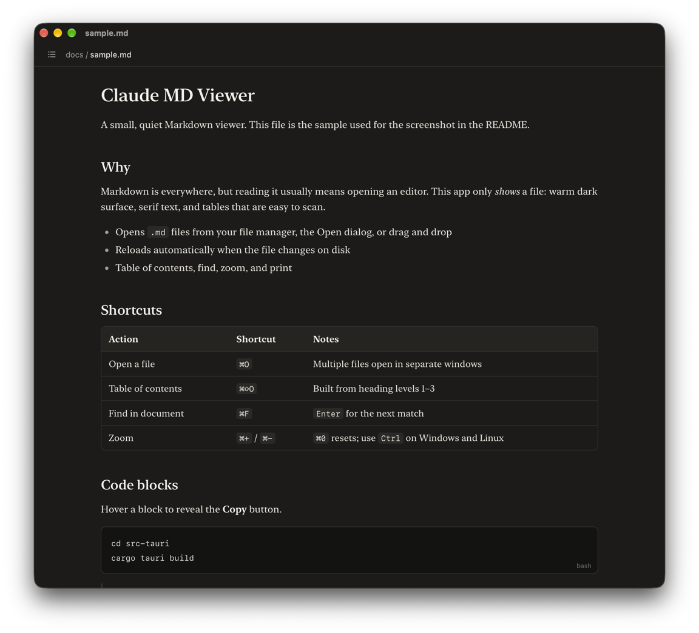

# Claude MD Viewer

[](https://github.com/ivantans/claude-md-viewer/releases/latest)
[](https://github.com/ivantans/claude-md-viewer/actions/workflows/build.yml)
[](https://github.com/ivantans/claude-md-viewer/releases)
[](LICENSE)

A lightweight Markdown viewer for macOS, Windows, and Linux with a reading experience modelled on the Markdown preview in the Claude app: warm dark surface, serif text, and rounded tables that are easy to scan.

It only *shows* Markdown — a `README.md`, a `CLAUDE.md`, notes written by an AI assistant — without opening an editor. The installers are **1–2 MB**: the app uses the web view that ships with your operating system instead of bundling a browser, so there is no Electron and no 100 MB download.

> **Unofficial project.** Claude MD Viewer is a community-made tool. It is not affiliated with, sponsored by, or endorsed by Anthropic. "Claude" is a trademark of Anthropic, used here only to describe the look this viewer is inspired by.



## Download

| Platform | Download | Size |
|---|---|---|
| macOS, Apple Silicon (M1 and later) | [Claude-MD-Viewer-macOS-Apple-Silicon.dmg](https://github.com/ivantans/claude-md-viewer/releases/latest/download/Claude-MD-Viewer-macOS-Apple-Silicon.dmg) | 1.5 MB |
| macOS, Intel | [Claude-MD-Viewer-macOS-Intel.dmg](https://github.com/ivantans/claude-md-viewer/releases/latest/download/Claude-MD-Viewer-macOS-Intel.dmg) | 1.7 MB |
| Windows 10 / 11 | [Claude-MD-Viewer-Windows-x64-setup.exe](https://github.com/ivantans/claude-md-viewer/releases/latest/download/Claude-MD-Viewer-Windows-x64-setup.exe) | 1.2 MB |
| Debian / Ubuntu | [Claude-MD-Viewer-Linux-amd64.deb](https://github.com/ivantans/claude-md-viewer/releases/latest/download/Claude-MD-Viewer-Linux-amd64.deb) | 1.9 MB |
| Fedora / openSUSE | [Claude-MD-Viewer-Linux-x86_64.rpm](https://github.com/ivantans/claude-md-viewer/releases/latest/download/Claude-MD-Viewer-Linux-x86_64.rpm) | 1.9 MB |

The builds are **not signed**, so the first launch needs one extra step. See [Install](#install).

## Features

- Opens `.md` files from your file manager (Open With), the Open dialog, or drag and drop
- Reloads automatically when the file changes on disk, keeping your scroll position
- Table of contents built from the document's headings
- Copy button on every code block
- Find in document, zoom, and print (or save as PDF)
- Dark, Light, and Match System themes
- Offers once to become your default app for Markdown files, and stays quiet after you answer
- Viewer only: it never modifies your files
- Works offline; the Markdown parser is bundled
- Lightweight: it uses the web view that ships with the operating system instead of bundling a browser, so the macOS app is about 3 MB

## Supported platforms

| Platform | Web view | Status |
|---|---|---|
| macOS 11 or later | WKWebView | Built and tested (Apple Silicon, macOS 27) |
| Windows 10 / 11 | Microsoft Edge WebView2 | Builds in CI, **not yet tested by the maintainer** |
| Linux (GTK 3, WebKitGTK 4.1) | WebKitGTK | Builds in CI, **not yet tested by the maintainer** |

If you try the Windows or Linux build, reports about what works and what does not are very welcome. See [Known limitations](#known-limitations).

## Install

The installers under [Download](#download) are built by [GitHub Actions](.github/workflows/build.yml) from this repository. They are not signed or notarized, which is why each system asks once before running them.

### macOS

The quickest way is one line in Terminal. It downloads the right build for your Mac and puts it in Applications; because the download does not go through a browser, macOS does not block the app:

```bash
curl -fsSL https://raw.githubusercontent.com/ivantans/claude-md-viewer/main/scripts/install.sh | sh
```

Or install the `.dmg` by hand:

1. Open the `.dmg` and drag **Claude MD Viewer** to Applications. Not sure which one you need? Apple menu → About This Mac: a chip named "Apple M…" means Apple Silicon.
2. Open the app once. macOS says it could not verify the app; click **Done**.
3. Open **System Settings → Privacy & Security**, scroll down, and click **Open Anyway**.

This is needed only the first time.

### Windows

Run the installer. SmartScreen asks for confirmation: click **More info → Run anyway**. It installs for the current user and does not need administrator rights.

### Linux

```bash
sudo apt install ./Claude-MD-Viewer-Linux-amd64.deb
```

```bash
sudo dnf install ./Claude-MD-Viewer-Linux-x86_64.rpm
```

WebKitGTK 4.1 must be available from your distribution (Ubuntu 22.04 or later, current Fedora).

### Build from source

If you would rather not run unsigned binaries, build it yourself. The first build downloads and compiles the Rust dependencies and takes a few minutes; later builds take well under a minute.

#### Prerequisites

All platforms need [Rust](https://rustup.rs) (stable) and the Tauri command line tool:

```bash
cargo install tauri-cli --version "^2" --locked
```

Then, per platform:

- **macOS**: the Xcode command line tools (`xcode-select --install`).
- **Windows**: the [Microsoft C++ Build Tools](https://visualstudio.microsoft.com/visual-cpp-build-tools/) with the "Desktop development with C++" workload. WebView2 is part of Windows 11 and of up-to-date Windows 10; the installer downloads it if it is missing.
- **Linux**: a C toolchain plus the WebKitGTK 4.1 development files.

  ```bash
  # Debian / Ubuntu 22.04 or later
  sudo apt install libwebkit2gtk-4.1-dev build-essential curl file librsvg2-dev
  ```

  ```bash
  # Fedora
  sudo dnf install webkit2gtk4.1-devel librsvg2-devel gcc gcc-c++ make curl file
  ```

  ```bash
  # Arch
  sudo pacman -S --needed webkit2gtk-4.1 librsvg base-devel curl file
  ```

Node.js is not needed: the user interface is plain HTML, CSS, and JavaScript with no build step.

#### Build

```bash
git clone https://github.com/ivantans/claude-md-viewer.git
cd claude-md-viewer/src-tauri
cargo tauri build
```

The results are written to `src-tauri/target/release/bundle/`:

| Platform | Output | What to do with it |
|---|---|---|
| macOS | `macos/Claude MD Viewer.app` and `dmg/*.dmg` | Move the app to your Applications folder |
| Windows | `nsis/*-setup.exe` | Run the installer (installs for the current user, no administrator rights needed) |
| Linux | `deb/*.deb` and `rpm/*.rpm` | `sudo apt install ./<file>.deb` or `sudo dnf install ./<file>.rpm` |

An app you built locally opens on macOS without a Gatekeeper warning.

To run from source while working on the code, use `cargo tauri dev` in `src-tauri`.

### Make it the default app for Markdown files

The app registers itself as a viewer for `.md`, `.markdown`, `.mdown`, and `.mkd`. Until it is the default, the bar at the top of the window offers to set it: **Set as default** does it for you on macOS and Linux, and on Windows opens the Default apps page of Settings, because Windows only lets you make that choice yourself. The **✕** next to it hides the offer for good.

To do it by hand:

- **macOS**: in Finder, select any `.md` file and press `⌘I` (Get Info). Under **Open with**, choose **Claude MD Viewer**, then click **Change All…**.
- **Windows**: right-click any `.md` file, choose **Open with → Choose another app**, pick **Claude MD Viewer**, and select **Always**. (Or: Settings → Apps → Default apps, then search for `.md`.)
- **Linux**: right-click a `.md` file in your file manager, open **Properties → Open With**, and set Claude MD Viewer as the default. From a terminal:

  ```bash
  xdg-mime default "Claude MD Viewer.desktop" text/markdown
  ```

## Keyboard shortcuts

On Windows and Linux, use `Ctrl` in place of `⌘`.

| Action | Shortcut |
|---|---|
| Open a file | `⌘O` |
| Reload | `⌘R` |
| Table of contents | `⌘⇧O` |
| Find / Find next | `⌘F` / `⌘G` (or `Enter`) |
| Zoom in / out / reset | `⌘+` / `⌘-` / `⌘0` |
| Print or save as PDF | `⌘P` |
| Close window | `⌘W` |

## How it works

The app has two halves.

The **shell** is one Rust file built with [Tauri 2](https://tauri.app). It owns everything that touches the operating system: windows (one per document), the menu, the Open dialog, drag and drop, files passed by "Open with", the theme, zoom, and printing. It reads the Markdown file and calls the page's `render()` function with its text. A background thread checks each open file's modification time once per second and renders again when it changes. A second launch hands its file to the instance that is already running.

The **page** is plain HTML, CSS, and JavaScript, shown in the system web view. `render()` parses the Markdown with [marked](https://github.com/markedjs/marked), sanitizes the result, and builds the table of contents. The page is identical on all three platforms.

The web view is locked down:

- A content security policy allows scripts and styles from the app itself only. Nothing remote is ever loaded as code, and inline scripts are blocked.
- The page can call exactly three shell commands (`ready`, `open_link`, `action`); no other Tauri API is granted (see `src-tauri/capabilities/default.json`).
- Images next to the Markdown file are served through a small `mdfile` protocol that only returns image files. The page cannot read any other kind of file.
- Links never navigate the viewer. `#anchors` scroll in place, links to Markdown files open in a new viewer window, `http`, `https`, and `mailto` links go to the default browser or mail app, and other local files open in their default app unless they are programs or scripts.

```
Resources/viewer.html        Page shell
Resources/viewer.css         All colors and typography
Resources/viewer.js          Rendering, table of contents, find, copy buttons
Resources/marked.min.js      Bundled Markdown parser (marked 12.0.2)
src-tauri/src/main.rs        The shell: windows, menus, file watching, links, images
src-tauri/tauri.conf.json    App metadata, content security policy, installers, file associations
src-tauri/capabilities/      What the page is allowed to ask the shell to do
src-tauri/icons/             App icon (icon.svg is the source)
scripts/install.sh           One-line installer for macOS
.github/workflows/build.yml  Builds for macOS, Windows, and Linux on every push and pull request
```

### Changing the look

Every color and font is a CSS variable at the top of `Resources/viewer.css`, with one block for dark and one for light. Edit, then run `cargo tauri dev` (or build again).

The serif font is whatever the system provides: New York on macOS, Georgia on Windows, and Source Serif, Noto Serif, or DejaVu Serif on Linux, depending on what is installed. No fonts are bundled.

## Known limitations

- **Windows and Linux are untested.** They compile in CI, but nobody has yet confirmed on a real machine that file associations, drag and drop, menus and shortcuts, printing, themes, and fonts behave as intended. The Intel macOS build is cross-compiled in CI and equally untested.
- Release builds are not signed or notarized
- No syntax highlighting in code blocks
- Only images are loaded from disk (PNG, JPEG, GIF, WebP, AVIF, SVG, BMP, ICO). Local audio and video embedded with raw HTML do not play, and images on Windows network shares (`\\server\share`) do not load.
- Links with schemes other than `http`, `https`, and `mailto` are ignored, and links to local programs, scripts, or files marked executable are not opened
- Linux: only `.deb` and `.rpm` packages are built. An AppImage would bundle WebKitGTK and be around 80 MB, which defeats the point; WebKitGTK 4.1 must be available from your distribution.
- Linux: the Edit → Copy menu item asks the page to copy and may not work everywhere; `Ctrl+C` always does
- File changes are detected by checking once per second, so a reload can lag by up to a second
- The palette was matched by eye from the Claude app, so it is close but not identical
- Raw HTML in Markdown is rendered after stripping scripts and event handlers; treat files from untrusted sources with the usual care

## Contributing

Issues and pull requests are welcome. The codebase is intentionally small: one Rust file for the shell, three hand-written files for the page, no JavaScript package manager, and no bundler. Please keep changes in that spirit.

## License

[MIT](LICENSE). Bundled third-party software is listed in [THIRD_PARTY_NOTICES.md](THIRD_PARTY_NOTICES.md).
